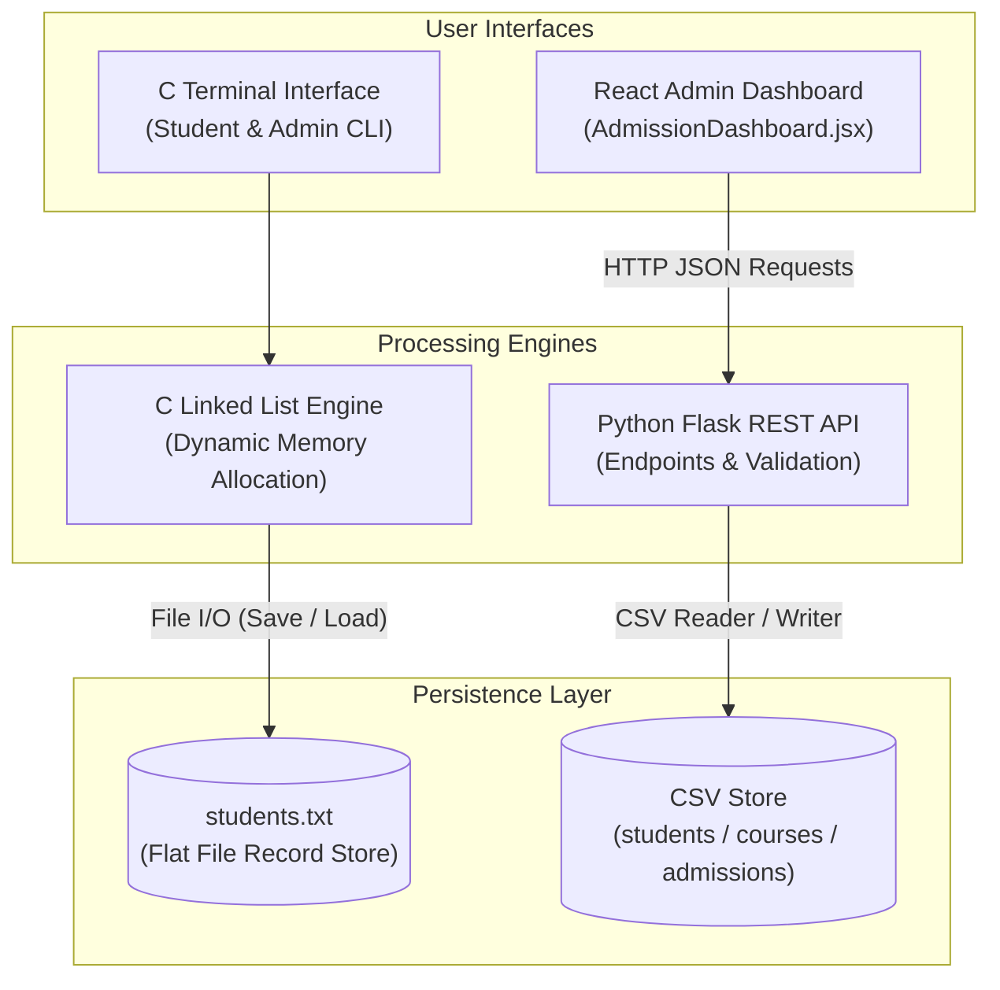
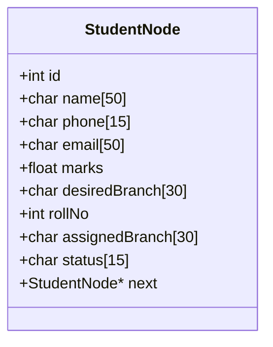
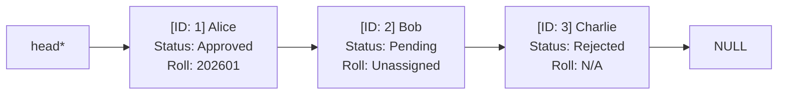

# Student Admission & Record Management System

[](https://en.wikipedia.org/wiki/C_(programming_language))
[](https://gcc.gnu.org/)
[](https://www.python.org/)
[](https://flask.palletsprojects.com/)
[](https://react.dev/)
[]()

A comprehensive multi-tier academic solution developed for the **Data Structures & Algorithms (DSA)** curriculum. It implements a student admission lifecycle through a native **C Singly Linked List engine**, backed by a **Python Flask REST API** and an interactive **React admin dashboard**.

---

## 🏛️ System Architecture



---

## 🔗 Data Structure: Singly Linked List Design

The core C engine models student applicants using dynamic heap allocation (`malloc` / `free`) connected through self-referential pointer structures:





---

## ⏱️ Algorithmic Complexity

| Operation | Function | Time Complexity | Space Complexity | Description |
| :--- | :--- | :---: | :---: | :--- |
| **Applicant Registration** | `insertEnd()` | $\mathcal{O}(n)$ | $\mathcal{O}(1)$ | Appends a new candidate node to the tail of the list |
| **Search by ID / Roll** | `searchStudent()` | $\mathcal{O}(n)$ | $\mathcal{O}(1)$ | Linear traversal through pointers |
| **Admin Decision** | `approveStudent()` | $\mathcal{O}(n)$ | $\mathcal{O}(1)$ | Finds applicant and assigns roll & branch |
| **File Persistence** | `saveToFile()` | $\mathcal{O}(n)$ | $\mathcal{O}(1)$ | Serializes linked list sequentially to disk |
| **File Deserialization** | `loadFromFile()` | $\mathcal{O}(n)$ | $\mathcal{O}(n)$ | Reconstructs in-memory list on application startup |

---

## 🚀 Running the Components

### 1. C Terminal Engine (`c-terminal-app/`)

Prerequisites: GCC compiler (`MinGW` on Windows or `gcc` on Linux/macOS).

```bash
cd c-terminal-app

# Compile
gcc admission_system.c -o admission_system

# Run
./admission_system
```

**Features:**
* **Student Mode**: Apply for admission, provide contact details, submit academic marks, and check real-time admission status.
* **Admin Mode**: Review queue of pending applications, grant approvals, assign official roll numbers, or reject candidates. All state automatically persists to `students.txt`.

---

### 2. Python Flask REST API (`flask-api/`)

Prerequisites: Python 3.10+

```bash
cd flask-api

# Install dependencies
pip install -r requirements.txt

# Run the API server
python app.py
```
*The server listens on `http://127.0.0.1:5000` with endpoints for students, courses, and admission processing backed by CSV storage.*

---

### 3. React Admin Dashboard (`react-dashboard/`)

The modern frontend dashboard component in `AdmissionDashboard.jsx` provides:
* Live search by student name and ID.
* Multi-parameter department filtering (Computer Science, Electronics, Mechanical, Civil).
* Status distribution metrics (Approved, Pending, Rejected).
* Responsive table view with badge indicators.

---

## 📂 Repository Structure

```text
DSA/
├── c-terminal-app/
│   ├── admission_system.c          # Core C terminal app with linked-list data structures & file I/O
│   └── students.txt                # Persistent record store
├── flask-api/
│   ├── app.py                      # Flask REST backend with CSV storage
│   └── requirements.txt            # Python dependencies
├── react-dashboard/
│   └── AdmissionDashboard.jsx      # Modern React dashboard component
├── .gitignore
└── README.md
```

---

## 📜 Academic Curriculum Mapping
* **Subject:** Data Structures & Algorithms (DSA).
* **Topics Covered:** Dynamic Memory Allocation (`malloc`, `free`), Singly Linked Lists, Pointer Manipulation, File I/O Streams, Linear Search, Separation of Concerns in Software Engineering.
